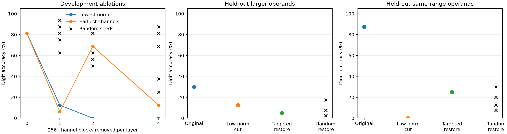

# Qwen3.5-4B pruning and restoration

This project studies how structured MLP pruning affects Qwen3.5-4B. It compares equal-size cuts in a Q4_K_M GGUF, checks that physical pruning reproduces runtime ablation, and tests whether restoring selected blocks recovers arithmetic accuracy.

The exporter removes 1,024 of 9,216 MLP channels per layer in groups of 256. It slices the matching rows of the gate and up projections and columns of the down projection, then updates the GGUF metadata. It copies surviving quantization blocks directly. Both compact models load in stock llama.cpp at revision `cf659f240`.

## Results

| Variant | GGUF size | Exact match | Median CPU decode |
| --- | ---: | ---: | ---: |
| Original | 2,614.0 MiB | 22/24 | 16.28 tok/s |
| Lowest down-projection norm | 2,468.6 MiB | 0/24 | 20.87 tok/s |
| Seeded random | 2,468.6 MiB | 21/24 | 21.05 tok/s |

Both cuts removed **251.7M MLP weight entries** and saved **145.3 MiB (5.56%)**. All 330 tensors outside the cut were byte-identical. The table reports a 24-question smoke test and median decode speeds over three 96-token runs per variant on four CPU threads, in fixed model order. [Raw benchmark data](data/benchmark.jsonl)

On 40 unseen addition problems from the development operand range, the original scored **35/40** on tens-digit prediction. The lowest-norm cut scored **0/40**, restoring blocks in four selected layers recovered **10/40**, and five equal-size random restorations ranged from **3–12/40**. Recovery did not repeat on the larger-operand split. In layer 29, the removed blocks had **16% lower mean weight norm** but **3.34× larger mean projected contributions** than retained blocks on the development prompts. [Methods and results](docs/RESTORATION.md)



## Repository layout

- [scripts/](scripts/) contains the GGUF exporter, experiment runners, and plotting script.
- [src/](src/) contains the C++ activation capture and masking harness.
- [data/](data/) contains pruning manifests and raw results.
- [figures/](figures/) contains the restoration plot.
- [docs/](docs/) contains the experiment report and reproduction instructions.

## Reproduce

Use a built llama.cpp checkout at revision `cf659f240` and an original Qwen3.5-4B Q4_K_M GGUF. The exporter requires NumPy and `gguf-py` from that checkout. The CPU benchmarks read Linux process memory statistics.

```bash
REPO=/absolute/path/to/qwen-pruning
LLAMA_CPP=/absolute/path/to/llama.cpp
MODEL=/absolute/path/to/Qwen3.5-4B-Q4_K_M.gguf
RUN=/absolute/path/to/fresh-run-directory

mkdir -p "$RUN"
cd "$RUN"
export PYTHONPATH="$LLAMA_CPP/gguf-py"
python3 "$REPO/scripts/prune_gguf.py" "$MODEL" norm.gguf --strategy norm
python3 "$REPO/scripts/prune_gguf.py" "$MODEL" random.gguf --strategy random
python3 "$REPO/scripts/benchmark.py" "$MODEL" "$LLAMA_CPP/build/bin/llama-server"
```

The restoration report covers the C++ build and full evaluation. Run `python3 scripts/plot_restoration.py` from the repo with Matplotlib installed to regenerate the figure from the published results. [Restoration reproduction steps](docs/RESTORATION.md)
